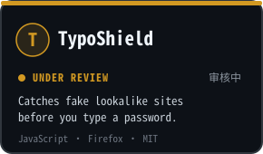
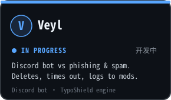
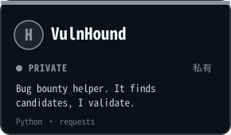
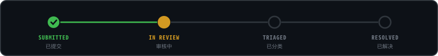

  

  
  
  
  
  

## 🔎 About · 关于

I look into things and check them twice. Phishing, lookalike domains, scam infrastructure and digital traces, mostly the kind that targets people in Southeast Asia. Physics student on the side.

> 眼见不一定为实,查证才算数。

## 🧰 Projects · 项目

  
  
  

## 🐞 Bug Bounty · 漏洞赏金

> A scanner hit is not a bug until you validate it by hand. · 扫描器说有洞,不算有洞。

## 🛠️ Toolbox · 工具

  
  
  
  
  

## 📫 Contact · 联系

  
  

<code>多查一步,少上一次当 · trust, but verify</code>

