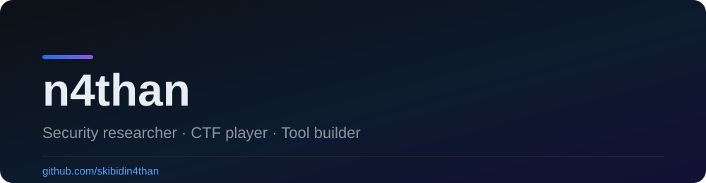

 

  

## 🚀 Featured projects

<table>
  <tr>
    <td width="50%" valign="top">
      <h3>🔍 <a href="https://github.com/skibidin4than/PromptProbe">PromptProbe</a></h3>
      
LLM prompt injection tester. 25 adversarial payloads, canary-based detection, JSON reports. Works with Ollama, OpenAI and any HTTP chatbot API.

      
    </td>
    <td width="50%" valign="top">
      <h3>🕵️ <a href="https://github.com/skibidin4than/SubTake">SubTake</a></h3>
      
Subdomain takeover checker. CNAME fingerprinting across 25 services, with crt.sh enumeration and JSON output.

      
    </td>
  </tr>
  <tr>
    <td colspan="2" valign="top">
      <h3>🌐 <a href="https://skibidin4than.github.io">skibidin4than.github.io</a></h3>
      
My personal website.

      
    </td>
  </tr>
</table>

## 🐛 Bug bounty & CTF

- **Bug bounty** — hunting on HackerOne VDPs with **VulnHound**, my own scanner (headers, XSS, disclosure, CORS, JS secrets, redirect).
- **WolvCTF 2026** — PWN, REV, WEB, CRYPTO, OSINT and forensics.

## 🧰 Tech stack

## 📊 Stats

## 🐍 Contribution snake

<picture>
  <source media="(prefers-color-scheme: dark)" srcset="https://raw.githubusercontent.com/skibidin4than/skibidin4than/output/github-snake-dark.svg"/>
  
</picture>

 

